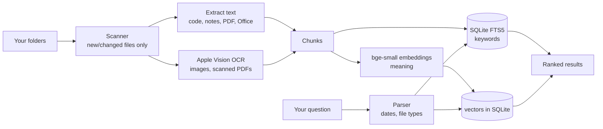

# Rummage

Search everything on your Mac in plain English. Fully offline: your files, the index and the AI model all stay on your computer.

- **"that receipt from October"** finds a photo of a receipt by the text printed on it.
- **"the code where I did pathfinding"** finds `enemy.gd`, even though the word "pathfinding" isn't in it.
- **"pdfs from last week"**, **"screenshots yesterday"**, **"python script for scraping"**, **"notes from march 2025"**.
- **"that petrol station game"** finds the game's project folder because the code inside it is about fuel pumps and customers, and lists the matching files.
- **"zombie survival folder"**, **"3d models"**, **"videos"**, **"blender"** filter by kind.

## Previews

Everything opens right in the page:

| File | Preview |
| --- | --- |
| Code | A summary instead of raw code: what it does (from its own comments or page title), language, what it extends, functions, signals, what it uses, tags like *pathfinding*, *multiplayer*, *UI*, and its main topic words. **Show code** shows the source. |
| HTML | Runs live with its own CSS, scripts and images, in a sandbox. **Source** flips to the summary and code. |
| 3D models | glb, gltf, fbx, obj (+mtl), stl, ply, dae and Blockbench `.bbmodel` (compressed too) in an orbit viewer with spin, wireframe, grid and fullscreen. Animations get a clip picker, play/pause, timeline and speed. |
| Textures stored elsewhere | If a model points at a texture that isn't next to it (often a path from another computer), Rummage finds the file by name in the same project. The texture button lists every image in the project, and clicking one puts it on the model. |
| `.blend` | Shows the preview image Blender saved in the file. **Show in 3D** has Blender export a copy in the background (your file isn't touched), then opens it in the viewer with its animations. |
| Video, audio | Plays with seeking. Formats the browser can't play can be converted with ffmpeg. |
| Images, PSD, Keynote, … | Thumbnails (Quick Look for design and office formats). |
| Projects | Folders whose files match get one result listing those files. Click one to open it. |

The loading sign shows a different moving symbol for each job: scanning folders, reading files, reading text in images, teaching the AI, loading a 3D model, converting with Blender or ffmpeg.

## Run it

Double-click **`Rummage.command`**. The first time, it installs its dependencies and downloads a small (~70 MB) AI model. After that it runs without internet.

Double-clicking again while it's running just opens the page. If Rummage's code was updated since that copy started, the launcher stops the old copy and starts the new version. Your index is kept.

A browser tab opens at `http://127.0.0.1:47615`. The first index takes a while; you can search as soon as files start showing up.

| Key | Action |
| --- | --- |
| `⌘K` | Focus search |
| `↑` `↓` | Move through results |
| `Enter` (in the search box) | Open the file |
| `⌘Enter` | Show it in Finder |
| `Esc` | Clear |

**Folders** (bottom right) chooses what gets searched. The defaults are Desktop, Documents and Downloads with **Read images** on, plus `~/Code` with it off. That way game sprites and textures don't get OCR'd.

## How it works



- **Keyword search**: SQLite FTS5 with BM25 ranking and word stemming. Matches in the file name count for more. Results that contain fewer than half of your words (and don't match by meaning) are dropped, as is anything scoring under 20% of the best result. The count is the real number of matches, and more load as you scroll.
- **Meaning search**: the first two passages of each file get a local embedding (`BAAI/bge-small-en-v1.5`, run with ONNX on the CPU). For code, the first passage leads with its summary. Your question is matched by similarity, and the two rankings are combined with reciprocal rank fusion.
- **Code summaries**: built offline when a file is indexed (functions, classes, signals, imports, the file's own description, tags detected from the APIs it uses, and frequent words). Tags and topic words are searchable, so "pathfinding" finds code that only says `AStar2D`.
- **Projects**: a project is the nearest folder with `project.godot`, `.git`, `package.json` and so on, or the top folder in a searched location. When at least two strong matches sit in one project, the project folder becomes a result.
- **Plain-English filters**: month names, "last week", "yesterday", "in 2024", "last 3 days", plus kinds ("pdf", "screenshots", "code", "notes", "folders", "3d models", "videos", "music", "python script", `ext:gd`). They show as chips under the search box. For "from October", a file passes if it was modified in October or mentions October in its text.
- **OCR**: Apple's built-in Vision framework, on-device. Scanned PDFs (pages with no text layer) get their first 10 pages OCR'd.
- **Incremental**: only new or changed files are re-read. It rescans every 15 minutes while open, or when you press **Re-index**.
- **Private**: the server listens on `127.0.0.1` only and rejects API requests from other websites. File URLs carry a secret token that changes every launch, and HTML previews run as a sandboxed opaque origin, so a page from your disk can't call Rummage or read other files.

The index lives in `~/.rummage/` (set `RUMMAGE_HOME` to move it). Delete that folder to start over.

## What it reads

| Kind | Files |
| --- | --- |
| Notes | txt, md, rtf, csv, log, … |
| Code | py, js, ts, gd, swift, html, css, json, c/cpp, cs, java, lua, sh, … (with summaries) |
| Documents | docx, pptx, xlsx, odt |
| PDF | text layer, or OCR for scans |
| Images | png, jpg, heic, webp, tiff, gif (OCR) |
| 3D models | glb, gltf, fbx, obj, stl, ply, dae, blend, bbmodel, usdz (part, bone and animation names from gltf and bbmodel) |
| Video, audio | mp4, mov, m4v, webm, mkv, avi, mp3, m4a, wav, flac, ogg |
| By name only | zip, dmg, psd, kra, aseprite, key, pages, epub, jar, svg, … |
| Folders | name, plus the names of what's inside |

Skipped: hidden folders, `node_modules`, `build`, `dist`, `venv`, git worktrees (`*-wt`), app bundles, text files over 2 MB. In folders with **Read images** off, sprites and sound effects inside asset folders (`assets`, `textures`, `sounds`, …) are skipped, but 3D models and videos there are kept. Very long files are keyword-indexed up to about 60,000 characters.

## Command line

```sh
uv run rummage                    # open the app
uv run rummage index              # update the index
uv run rummage search "receipt from october"
uv run rummage add ~/School       # add a folder (--no-ocr to skip images)
uv run rummage remove ~/Downloads
uv run rummage folders
uv run rummage stats
```

Requires macOS (for Vision OCR and Quick Look) and [uv](https://docs.astral.sh/uv/). Optional: Blender (3D view of `.blend` files) and ffmpeg (video thumbnails and conversion). Both are found automatically.
