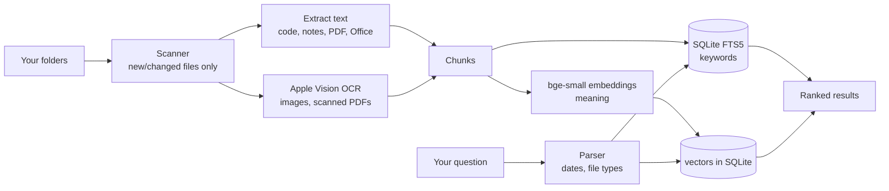

# Rummage

Search everything on your Mac in plain English. Fully offline: your files, the index and the AI model all stay on your computer.

- **"that receipt from October"** finds a photo of a receipt by the text printed on it.
- **"the code where I did pathfinding"** finds `enemy.gd`, even though the word "pathfinding" isn't in it.
- **"pdfs from last week"**, **"screenshots yesterday"**, **"python script for scraping"**, **"notes from march 2025"**.
- **"zombie survival folder"** finds folders too, by name or by what's in them.

## Run it

Double-click **`Rummage.command`**. The first time, it installs its dependencies and downloads a small (~70 MB) AI model. After that it runs without internet.

A browser tab opens at `http://127.0.0.1:47615`. The first index takes a while; you can search as soon as files start showing up.

| Key | Action |
| --- | --- |
| `⌘K` | Focus search |
| `↑` `↓` | Move through results |
| `Enter` | Open the file |
| `⌘Enter` | Show it in Finder |
| `Esc` | Clear |

**Folders** (bottom right) chooses what gets searched. The defaults are Desktop, Documents and Downloads with **Read images** on, plus `~/Code` with it off. That way game sprites and textures don't get OCR'd.

## How it works



- **Keyword search**: SQLite FTS5 with BM25 ranking and word stemming. Matches in the file name count for more.
- **Meaning search**: each chunk of text gets a local embedding (`BAAI/bge-small-en-v1.5`, run with ONNX on the CPU). Your question is matched by similarity. The two rankings are combined with reciprocal rank fusion.
- **Plain-English filters**: month names, "last week", "yesterday", "in 2024", "last 3 days", plus file types ("pdf", "screenshots", "code", "notes", "python script", `ext:gd`). They show as chips under the search box. For "from October", a file passes if it was modified in October or mentions October in its text.
- **OCR**: Apple's built-in Vision framework, on-device. Scanned PDFs (pages with no text layer) get their first 10 pages OCR'd.
- **Incremental**: only new or changed files are re-read. It rescans every 15 minutes while open, or when you press **Re-index**.
- **Private**: the server listens on `127.0.0.1` only and rejects requests from other websites.

The index lives in `~/.rummage/` (set `RUMMAGE_HOME` to move it). Delete that folder to start over.

## What it reads

| Kind | Files |
| --- | --- |
| Notes | txt, md, rtf, csv, log, … |
| Code | py, js, ts, gd, swift, html, css, json, c/cpp, cs, java, lua, sh, … |
| Documents | docx, pptx, xlsx, odt |
| PDF | text layer, or OCR for scans |
| Images | png, jpg, heic, webp, tiff, gif (OCR) |
| By name only | zip, dmg, mp4, mov, mp3, blend, bbmodel, psd, glb, … |
| Folders | name, plus the names of what's inside |

Skipped: hidden folders, `node_modules`, `build`, `dist`, `venv`, git worktrees (`*-wt`), app bundles, text files over 2 MB. Very long files are indexed up to about 60,000 characters.

## Command line

```sh
uv run rummage                    # open the app
uv run rummage index              # update the index
uv run rummage search "receipt from october"
uv run rummage add ~/School       # add a folder (--no-ocr to skip images)
uv run rummage remove ~/Downloads
uv run rummage folders
uv run rummage stats
```

Requires macOS (for Vision OCR) and [uv](https://docs.astral.sh/uv/).
